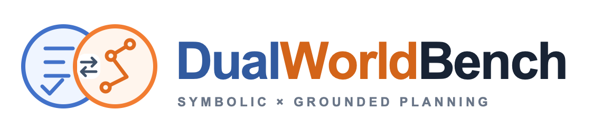
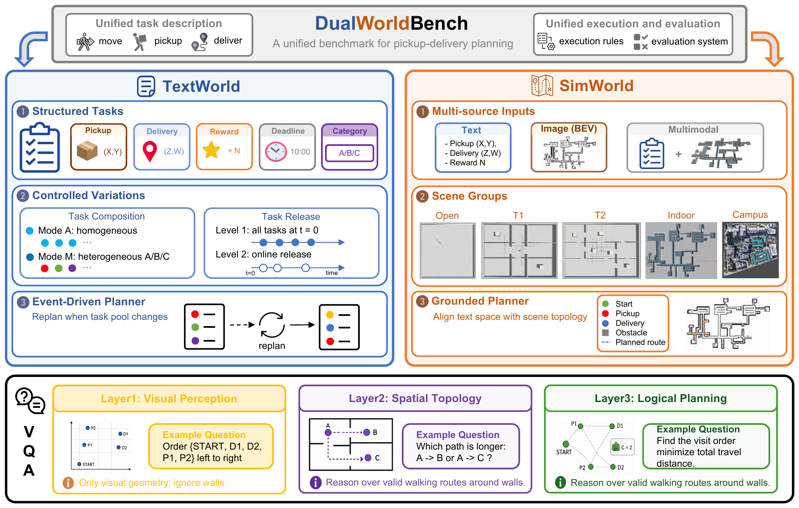

<p align="center">
  
</p>

<h3 align="center">Can Agents Plan Deliveries across Symbolic and Grounded Worlds?</h3>

<p align="center"><strong>Accepted at NeurIPS 2026</strong></p>

<p align="center">
  Yang Chen · Bin Wen · Danyang Peng · Hong-Jie You · Zi-Qiao Shang · Lan-Zhe Guo<br>
  Nanjing University · Shanghai Innovation Institute
</p>

<p align="center">
  <a href="https://dualworld.netlify.app/"></a>
  
  <a href="https://www.python.org/"></a>
  <a href="LICENSE"></a>
</p>

<p align="center">
  <a href="https://dualworld.netlify.app/">Website</a> ·
  <a href="docs/evaluation.md">Evaluation Guide</a> ·
  <a href="docs/interfaces.md">API &amp; Data</a> ·
  <a href="README.zh-CN.md">中文</a>
</p>

**DualWorldBench** evaluates pickup-and-delivery planning across symbolic scheduling, grounded navigation, and visual reasoning.

<p align="center">
  
</p>

## Benchmark

| Module | Focus | Included data |
|---|---|---|
| **TextWorld** | Scheduling with rewards, deadlines, capacity and online tasks | 200 episodes |
| **SimWorld** | Route planning from text, images or both | 189 instances · 13 scenes |
| **DualWorld-VQA** | Visual perception, spatial topology and constrained planning | 1,665 questions |

Task data, maps, navigation matrices and offline scorers are included. Evaluation runs with Python 3.10+ using the supplied resources.

## Quick start

Run from the repository root:

```bash
python3 -m venv .venv
source .venv/bin/activate
pip install -r requirements.txt
python -m dualworld validate
```

Configure an OpenAI-compatible model endpoint:

```bash
export OPENAI_API_KEY="YOUR_API_KEY"
export OPENAI_BASE_URL="https://api.openai.com/v1"
```

```bash
# TextWorld
python -m dualworld textworld --mode llm --model YOUR_MODEL_ID

# SimWorld
python -m dualworld simworld --models YOUR_MODEL_ID --workers 1

# DualWorld-VQA
python -m dualworld dualworld-vqa --model YOUR_MODEL_ID --vqa-set l1 l2 l3 --parallelism 1
```

For a local baseline without an API key, use `textworld --mode algo`. See the [evaluation guide](docs/evaluation.md) for small trial runs and scoring, [interfaces](docs/interfaces.md) for custom models, and [protocol](docs/protocol.md) for metric definitions.

## Citation

```bibtex
@inproceedings{chen2026dualworldbench,
  title={DualWorldBench: Can Agents Plan Deliveries across Symbolic and Grounded Worlds?},
  author={Chen, Yang and Wen, Bin and Peng, Danyang and You, Hong-Jie and Shang, Zi-Qiao and Guo, Lan-Zhe},
  booktitle={Advances in Neural Information Processing Systems},
  year={2026},
  url={https://dualworld.netlify.app/}
}
```

Code: [MIT](LICENSE). Benchmark data and maps: [CC BY 4.0](data/LICENSE).
