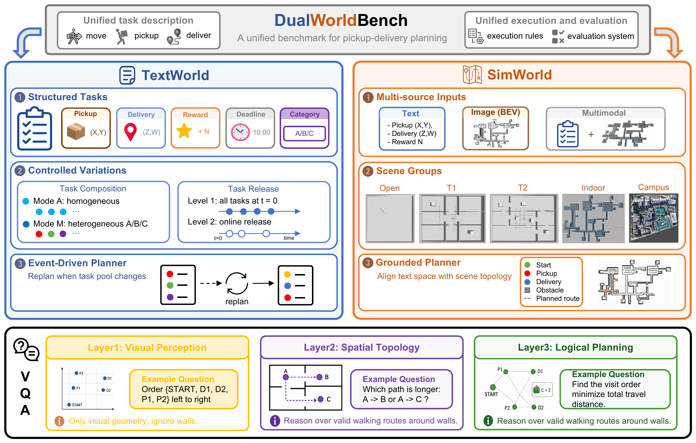

<p align="center">
  
</p>

<h3 align="center">Can Agents Plan Deliveries across Symbolic and Grounded Worlds?</h3>

<p align="center"><strong>NeurIPS 2026 已接收</strong></p>

<p align="center">
  <a href="https://dualworld.netlify.app/"></a>
  
  <a href="LICENSE"></a>
</p>

<p align="center">
  <a href="https://dualworld.netlify.app/">项目网站</a> ·
  <a href="README.md">English</a> ·
  <a href="docs/evaluation.md">运行指南</a> ·
  <a href="docs/interfaces.md">接口与数据</a>
</p>

**DualWorldBench** 是面向取送任务的智能体规划基准，涵盖符号调度、场景导航和视觉推理。

<p align="center">
  
</p>

| 模块 | 评测内容 | 数据规模 |
|---|---|---|
| **TextWorld** | 奖励、截止时间、容量约束与在线任务调度 | 200 个任务实例 |
| **SimWorld** | 文本、图像及多模态输入下的路线规划 | 13 个场景 · 189 个实例 |
| **DualWorld-VQA** | 视觉感知、空间拓扑与约束规划 | 1,665 道题 |

## 快速开始

需要 Python 3.10+，在仓库根目录运行：

```bash
python3 -m venv .venv
source .venv/bin/activate
pip install -r requirements.txt
python -m dualworld validate
```

```bash
export OPENAI_API_KEY="YOUR_API_KEY"
export OPENAI_BASE_URL="https://api.openai.com/v1"

python -m dualworld textworld --mode llm --model YOUR_MODEL_ID
python -m dualworld simworld --models YOUR_MODEL_ID --workers 1
python -m dualworld dualworld-vqa --model YOUR_MODEL_ID --vqa-set l1 l2 l3 --parallelism 1
```

无需 API 的本地基线可使用 `textworld --mode algo`。小规模试跑、离线评分见 [运行指南](docs/evaluation.md)，模型接入见 [接口说明](docs/interfaces.md)，指标定义见 [评测协议](docs/protocol.md)。

引用格式见 [英文 README](README.md#citation)。代码采用 [MIT](LICENSE)，数据与地图采用 [CC BY 4.0](data/LICENSE)。
